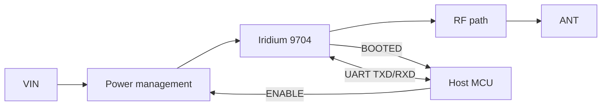

# BEAR Module 9704 Datasheet

Document ID: BEAR-DS-9704 | Revision: P1 | Status: Preliminary

Preliminary information. Specifications may change. Proposed targets are not released specifications; every proposed target is marked **[Pending decision]** and requires design review and verification before release.

The BEAR Module 9704 is designed as a host-independent satellite communications module for production-qualified deployment. It is currently in development and is not yet production-qualified. The TI MSP430F169 is the first SDK reference host, not a requirement for using the module.

## Features

- Iridium 9704 satellite modem for IoT messaging
- Power management with managed boot and shutdown
- Energy storage for transmit bursts (target)
- UART interface, 230400 baud 8N1
- ENABLE and BOOTED handshake signals
- Antenna configuration: options and qualification scope **[Pending decision]**
- Telemetry Station SDK in portable C99, with an MSP430F169 first reference port
- Host-independent interface: UART, ENABLE and BOOTED; no specific host MCU required

## Applications

Remote environmental monitoring, asset tracking, marine and polar buoys, agriculture, utilities, infrastructure.

## Block diagram

## Signals

| Signal | Direction (module) | Description |
|---|---|---|
| VIN | In | Supply |
| GND | Power | Ground |
| ENABLE | In | High starts the module. Low starts shutdown |
| BOOTED | Out | High when ready. Low when shut down |
| TXD | Out | Serial data to host |
| RXD | In | Serial data from host |
| TX_ACTIVE | Out | Optional transmit indicator |
| WAKE_IN, WAKE_OUT | Reserved | Future use |
| ANT | RF | Antenna connection |

Pin numbers and connector selection: **[Pending decision]**. See [03 Hardware interface](../docs/03_Hardware_Interface.md).

## Ratings and characteristics

| Parameter | Min | Typ | Max |
|---|---|---|---|
| Absolute maximum supply voltage | TBD — derive from input protection and OEM limits **[Pending decision]** | | TBD — derive from input protection and OEM limits **[Pending decision]** |
| Recommended supply voltage | 4.5 V proposed **[Pending decision]** | 5.0 V proposed **[Pending decision]** | 5.5 V proposed **[Pending decision]** |
| Host I/O logic | 3.3 V CMOS proposed; thresholds TBD **[Pending decision]** | | 5 V tolerance not established **[Pending decision]** |
| Current, disabled | TBD — characterize **[Pending decision]** | TBD — characterize **[Pending decision]** | TBD — characterize **[Pending decision]** |
| Current, idle | TBD — characterize **[Pending decision]** | TBD — characterize **[Pending decision]** | TBD — characterize **[Pending decision]** |
| Current, transmit (peak, average) | TBD — characterize against OEM profile **[Pending decision]** | TBD — characterize against OEM profile **[Pending decision]** | TBD — characterize against OEM profile **[Pending decision]** |
| Operating temperature | -40 °C proposed **[Pending decision]** | | +85 °C proposed **[Pending decision]** |

## Timing

| Parameter | Description | Value |
|---|---|---|
| t_BOOT | ENABLE high to BOOTED high | TBD — characterize and set timeout margin **[Pending decision]** |
| t_DOWN | ENABLE low to BOOTED low | TBD — characterize **[Pending decision]** |
| t_VIN | Supply stable to ENABLE allowed | TBD — derive from regulator startup and power-good behavior **[Pending decision]** |
| t_UART | BOOTED high to first serial command | TBD — verify against modem behavior **[Pending decision]** |

Always wait for BOOTED before using the UART and before removing power. See [04 Power management](../docs/04_Power_Management.md).

## RF, mechanical, environmental

| Parameter | Value |
|---|---|
| Frequency | Iridium L-band, 1616 to 1626.5 MHz |
| Antenna impedance | 50 Ω nominal proposed **[Pending decision]** |
| Dimensions and mass | TBD — establish from mechanical design **[Pending decision]** |
| Environmental | See [08](../docs/08_Mechanical_and_Environmental.md) |

## Regulatory

See [09 Compliance and quality](../docs/09_Compliance_and_Quality.md).

## Ordering

See [11 Ordering and support](../docs/11_Ordering_and_Support.md).

## Revision history

| Revision | Date | Change |
|---|---|---|
| P1 | October 2026 | Preliminary release |
