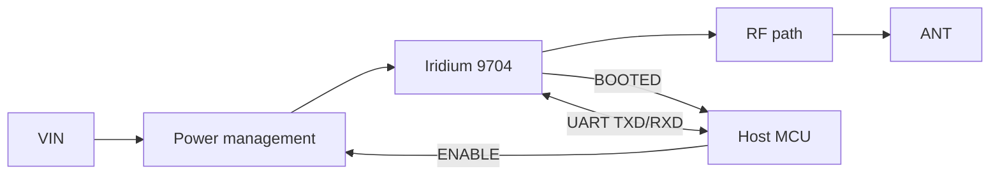

# BEAR Module 9704 Datasheet

Document ID: BEAR-DS-9704 | Revision: P1 | Status: Preliminary

Preliminary information. Specifications may change. Values marked "Coming soon" are published at Rev A.

## Features

- Iridium 9704 satellite modem for IoT messaging
- Power management with managed boot and shutdown
- Energy storage for transmit bursts (target)
- UART interface, 230400 baud 8N1
- ENABLE and BOOTED handshake signals
- Antenna options: connector or qualified antenna
- Telemetry Station SDK in portable C99, with an MSP430F169 reference port
- Works with any microcontroller with one UART and two GPIOs

## Applications

Remote environmental monitoring, asset tracking, marine and polar buoys, agriculture, utilities, infrastructure.

## Block diagram

## Signals

| Signal | Direction (module) | Description |
|---|---|---|
| VIN | In | Supply |
| GND | Power | Ground |
| ENABLE | In | High starts the module. Low starts shutdown |
| BOOTED | Out | High when ready. Low when shut down |
| TXD | Out | Serial data to host |
| RXD | In | Serial data from host |
| TX_ACTIVE | Out | Optional transmit indicator |
| WAKE_IN, WAKE_OUT | Reserved | Future use |
| ANT | RF | Antenna connection |

Pin numbers and connector: published at Rev A. See [03 Hardware interface](../docs/03_Hardware_Interface.md).

## Ratings and characteristics

| Parameter | Min | Typ | Max |
|---|---|---|---|
| Absolute maximum supply voltage | Coming soon | | Coming soon |
| Recommended supply voltage | Coming soon | | Coming soon |
| Logic levels | Coming soon | | Coming soon |
| Current, disabled | | Coming soon | Coming soon |
| Current, idle | | Coming soon | Coming soon |
| Current, transmit (peak, average) | | Coming soon | Coming soon |
| Operating temperature | Coming soon | | Coming soon |

## Timing

| Parameter | Description | Value |
|---|---|---|
| t_BOOT | ENABLE high to BOOTED high | Coming soon |
| t_DOWN | ENABLE low to BOOTED low | Coming soon |
| t_VIN | Supply stable to ENABLE allowed | Coming soon |
| t_UART | BOOTED high to first serial command | Coming soon |

Always wait for BOOTED before using the UART and before removing power. See [04 Power management](../docs/04_Power_Management.md).

## RF, mechanical, environmental

| Parameter | Value |
|---|---|
| Frequency | Iridium L-band, 1616 to 1626.5 MHz |
| Antenna impedance | Coming soon |
| Dimensions and mass | Coming soon |
| Environmental | See [08](../docs/08_Mechanical_and_Environmental.md) |

## Regulatory

See [09 Compliance and quality](../docs/09_Compliance_and_Quality.md).

## Ordering

See [11 Ordering and support](../docs/11_Ordering_and_Support.md).

## Revision history

| Revision | Date | Change |
|---|---|---|
| P1 | October 2026 | Preliminary release |
