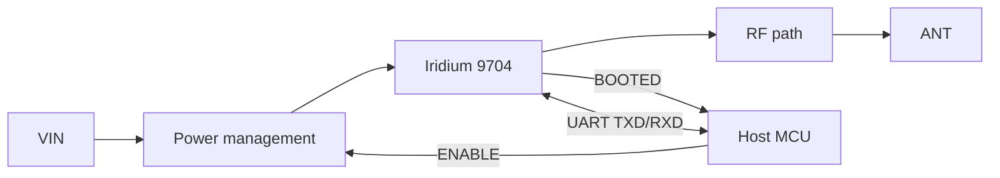

# BEAR Module 9704 Datasheet

Document ID: BEAR-DS-9704 | Revision: P2 | Status: Preliminary (Rev A design values; not yet measured)

Preliminary information. Specifications may change. Values below are the Rev A design values, not measured or released specifications. Items that can only be established by measurement are marked **Characterize at EVT**. Remaining open items, including vendor limits awaiting publication clearance, are marked **[Pending decision]**. Native board files and internal engineering reports are not included in this SDK.

The BEAR Module 9704 is designed as a host-independent satellite communications module for production-qualified deployment. It is currently in development and is not yet production-qualified. The TI MSP430F169 is the first SDK reference host, not a requirement for using the module.

## Features

- Iridium 9704 satellite modem for IoT messaging
- Power management with managed boot and shutdown
- 2.5 F supercapacitor energy storage for transmit bursts, so a 5 V / 0.5 A host source is sufficient
- UART interface, 230400 baud 8N1
- ENABLE and BOOTED handshake signals
- SMA antenna connector (50 Ω); Maxtena M1621HCT-P-SMA reference antenna
- Buffered 3.3 V host I/O, 5.5 V-tolerant and safe when either side is unpowered
- Telemetry Station SDK in portable C99, with an MSP430F169 first reference port
- Host-independent interface: UART, ENABLE and BOOTED; no specific host MCU required

## Applications

Remote environmental monitoring, asset tracking, marine and polar buoys, agriculture, utilities, infrastructure.

## Block diagram

## Signals

| Signal | Direction (module) | Description |
|---|---|---|
| VIN | In | Supply |
| GND | Power | Ground |
| ENABLE | In | High starts the module. Low starts shutdown |
| BOOTED | Out | High when ready. Low when shut down |
| TXD | Out | Serial data to host |
| RXD | In | Serial data from host |
| TX_ACTIVE | Out | Optional transmit indicator |
| WAKE_IN, WAKE_OUT | Reserved | Future use; Rev A test pads TP10/TP9 only |
| ANT | RF | Antenna connection |

Host connector J1: Molex Micro-Fit 3.0 43045-1012 (2 × 5, 3.0 mm pitch, keyed). Mating housing 43025-1000 with 43030-0007 crimp terminals.

| J1 pin | Signal | J1 pin | Signal |
|---|---|---|---|
| 1 | VIN | 2 | VIN |
| 3 | GND | 4 | GND |
| 5 | ENABLE | 6 | BOOTED |
| 7 | TXD | 8 | RXD |
| 9 | TX_ACTIVE | 10 | Reserved (no connect) |

RF connector J2: Amphenol 132134 SMA jack, vertical. See [03 Hardware interface](../docs/03_Hardware_Interface.md).

## Ratings and characteristics

| Parameter | Min | Typ | Max | Basis |
|---|---|---|---|---|
| Absolute maximum supply voltage | −20 V (reverse) | | 6.0 V continuous | Q1 DMP3099L V_GS ±20 V; D1 SMAJ6.0A V_RWM 6.0 V (conducts from 6.67 V) |
| Recommended supply voltage (VIN) | 4.75 V | 5.0 V | 5.25 V | Rev A power design |
| Supply source capability | 0.5 A | | | Worst-case input current 0.44 A (charger I_CHG 0.36 / 0.40 / 0.44 A) |
| Host input V_IH (ENABLE, RXD) | 2.0 V | | 5.5 V | SN74LVC1G125 at V_CC 3.0–3.6 V |
| Host input V_IL (ENABLE, RXD) | 0 V | | 0.8 V | SN74LVC1G125 |
| Host output V_OH (BOOTED, TXD, TX_ACTIVE) | 2.4 V at −16 mA | 3.3 V | | SN74LVC1G125 at V_CC 3.0 V |
| Host output V_OL | | | 0.55 V at 24 mA | SN74LVC1G125 |
| Unpowered behavior | | | ±10 µA | I_off; I/O safe with either side unpowered |
| Current, disabled (ENABLE low, bank full) | | | | Characterize at EVT; Rev A test limit < 5 mA |
| Current, transmit | | | 0.44 A from VIN | Burst current comes from the supercapacitor bank, not VIN. Modem burst current is not published by Iridium; Rev A design envelope 2.0 A from the bank. Characterize at EVT |
| Operating temperature | −40 °C target | | +85 °C target | Confirm component limits and verify at DVT **[Pending decision]** |

## Timing

| Parameter | Description | Value |
|---|---|---|
| t_VIN | Supply applied to ENABLE allowed | ≥ 35 s (bank charge from empty: 26 s typical, longer under charger thermal regulation). Rev A has no hardware supervisor |
| t_BOOT | ENABLE high to BOOTED high | Not published by Iridium. Characterize at EVT; the SDK uses a timeout |
| t_DOWN | ENABLE low to BOOTED low | Not published by Iridium. Characterize at EVT |
| t_UART | BOOTED high to first serial command | Not published by Iridium. Characterize at EVT |

Always wait for BOOTED before using the UART and before removing power. See [04 Power management](../docs/04_Power_Management.md).

## RF, mechanical, environmental

| Parameter | Value |
|---|---|
| Frequency | Iridium L-band, 1616 to 1626.5 MHz |
| Antenna impedance | 50 Ω; 0.34 mm microstrip on fabricator-controlled impedance |
| Antenna | Maxtena M1621HCT-P-SMA (2.8 dBic) reference selection; approved gain limits and installation conditions **[Pending decision]** |
| Conducted transmit power (modem) | Publish permitted specifications and verify at EVT **[Pending decision]** |
| Dimensions | 80 × 60 × 1.6 mm PCB, R5 corners; 4 × M3 holes (Ø3.2 mm) on a 72 × 52 mm pattern |
| Mass | Weigh at EVT **[Pending decision]** |
| Environmental | See [08](../docs/08_Mechanical_and_Environmental.md) |

## Regulatory

See [09 Compliance and quality](../docs/09_Compliance_and_Quality.md).

## Ordering

See [11 Ordering and support](../docs/11_Ordering_and_Support.md).

## Revision history

| Revision | Date | Change |
|---|---|---|
| P2 | 2026-11-07 | Rev A design values: connector and pinout, supply, logic levels, protection, t_VIN, RF and mechanical. Unpublished modem currents and timing marked for EVT characterization |
| P1 | October 2026 | Preliminary release |
