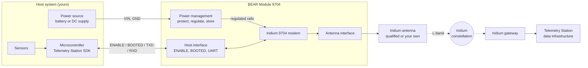
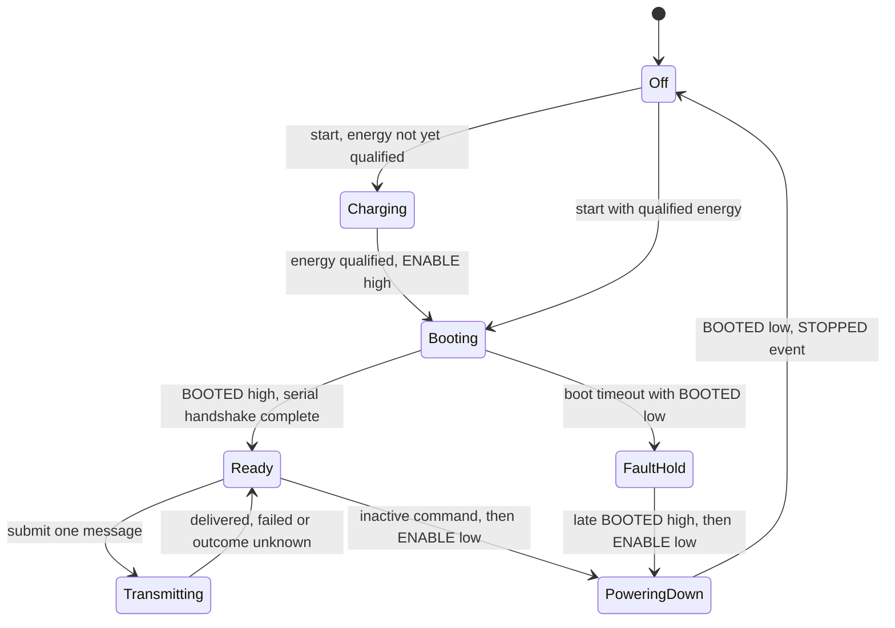

# 02 System Architecture

Your sensor makes a reading. Your microcontroller runs the SDK, BEAR sends the message through Iridium, and your configured destination receives it. This page shows which part owns each job.

**Start here:** [try the complete software sample](../../Telemetry_Station_SDK/docs/GETTING_STARTED.md#2-see-it-work-with-no-hardware). Use the diagrams below when planning your product.

Document ID: BEAR-SA-9704 | Revision: P2 (2026-11-15) | Status: Preliminary

BEAR Module 9704 is defined as a host-independent satellite communications module intended for production-qualified deployment. Its host MCU belongs to the customer's system; no specific MCU is required. Production qualification remains in progress and is not implied by this preliminary architecture.

## Block diagram

## Subsystems

| Subsystem | Responsibility | Detail |
|---|---|---|
| Iridium 9704 modem | Satellite link, message transport, serial command interface | [Datasheet](../datasheet/BEAR-9704_Datasheet.md) |
| Power management | Protect the input, produce modem rails and store energy; host/SDK control sequencing | [04 Power management](04_Power_Management.md) |
| Host interface | Present a simple, microcontroller-friendly connection | [03 Hardware interface](03_Hardware_Interface.md) |
| Antenna interface | Connect the modem to an Iridium L-band antenna | [05 Antenna and RF](05_Antenna_and_RF.md) |
| Mechanical | Board outline, mounting, connectors | [08 Mechanical](08_Mechanical_and_Environmental.md) |
| Firmware | Driver, hardware abstraction, IMEI and activation guidance | [07 Firmware interface](07_Firmware_Interface.md) |

## Design principles

1. **Few signals.** A host needs power, ground, ENABLE, BOOTED and a two-wire UART. Everything else is optional.
2. **Responsibilities are explicit.** The module supplies protection and burst-energy storage. The host qualifies stored energy; the SDK performs startup and shutdown. Rev A has no autonomous energy-ready supervisor.
3. **Host independent.** The module does not require a particular MCU or vendor-specific bus. The host must meet the released electrical and timing specifications and have an SDK port or equivalent driver.
4. **Firmware does not guess.** The SDK waits for BOOTED, never retries a send on its own, and reports delivery separately from acceptance.
5. **Traceable.** Every module is serialized and linked to its IMEI for activation, support and production traceability.

## Operating states

This is the normal path plus the boot-timeout exception. A timeout does not authorize cutting power. `FaultHold` keeps ENABLE asserted and requires continued polling or reviewed hardware recovery. The [complete SDK state reference](../../Telemetry_Station_SDK/docs/DESIGN.md#state-machine) covers other fault paths.

These states match the SDK driver states and events described in [07 Firmware interface](07_Firmware_Interface.md).

## Data path

1. The host encodes a reading into a compact payload with the `payload.c` generated by the Payload Optimizer.
2. The SDK frames it with a 2-byte CRC and sends it to the modem over the UART.
3. The modem transmits it over Iridium L-band. The constellation relays it to an Iridium gateway.
4. The gateway delivers it to the topic activated for the modem's IMEI, at Telemetry Station.
5. The configured destination must use the same schema to decode the reading. Confirm that destination and decoder during setup; automatic cloud decoding is not established by this repository. The [included local decoder](../../Telemetry_Station_SDK/docs/GETTING_STARTED.md#see-the-decoded-reading) demonstrates the sample format.

Messages in the other direction (cloud to device) follow the same path in reverse and are supported by the SDK when enabled.

**Next:** [check the connection requirements](03_Hardware_Interface.md) for your host.
