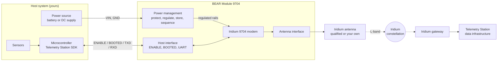
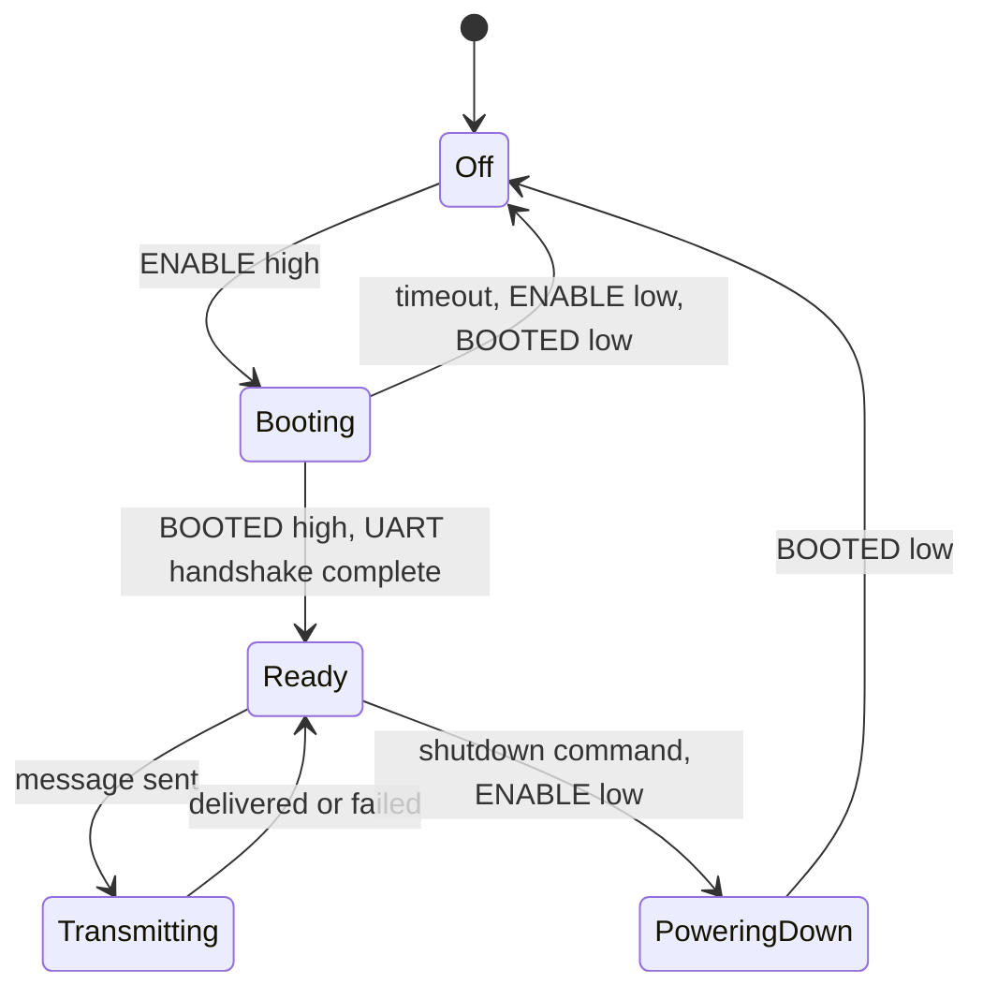

# 02 System Architecture

Document ID: BEAR-SA-9704 | Revision: P1 | Status: Preliminary

## Block diagram

## Subsystems

| Subsystem | Responsibility | Detail |
|---|---|---|
| Iridium 9704 modem | Satellite link, message transport, serial command interface | [Datasheet](../datasheet/BEAR-9704_Datasheet.md) |
| Power management | Protect the input, produce the modem rails, supply transmit bursts, sequence start-up and shutdown | [04 Power management](04_Power_Management.md) |
| Host interface | Present a simple, microcontroller-friendly connection | [03 Hardware interface](03_Hardware_Interface.md) |
| Antenna interface | Connect the modem to an Iridium L-band antenna | [05 Antenna and RF](05_Antenna_and_RF.md) |
| Mechanical | Board outline, mounting, connectors | [08 Mechanical](08_Mechanical_and_Environmental.md) |
| Firmware | Driver, hardware abstraction, IMEI and activation guidance | [07 Firmware interface](07_Firmware_Interface.md) |

## Design principles

1. **Few signals.** A host needs power, ground, ENABLE, BOOTED and a two-wire UART. Everything else is optional.
2. **The module protects itself.** Start-up and shutdown order, input protection and burst handling live on the module, not in your design.
3. **Microcontroller neutral.** No bus, clock or voltage beyond what a typical 3.3 V microcontroller provides.
4. **Firmware does not guess.** The SDK waits for BOOTED, never retries a send on its own, and reports delivery separately from acceptance.
5. **Traceable.** Every module is serialized and linked to its IMEI for activation, support and production traceability.

## Operating states

These states match the SDK driver states and events described in [07 Firmware interface](07_Firmware_Interface.md).

## Data path

1. The host encodes a reading into a compact payload with the `payload.c` generated by the Payload Optimizer.
2. The SDK frames it with a 2-byte CRC and sends it to the modem over the UART.
3. The modem transmits it over Iridium L-band. The constellation relays it to an Iridium gateway.
4. The gateway delivers it to the topic activated for the modem's IMEI, at Telemetry Station.
5. Telemetry Station decodes it with the same schema that generated the payload code.

Messages in the other direction (cloud to device) follow the same path in reverse and are supported by the SDK when enabled.
