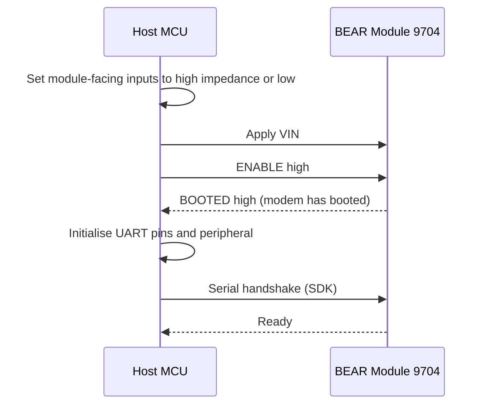
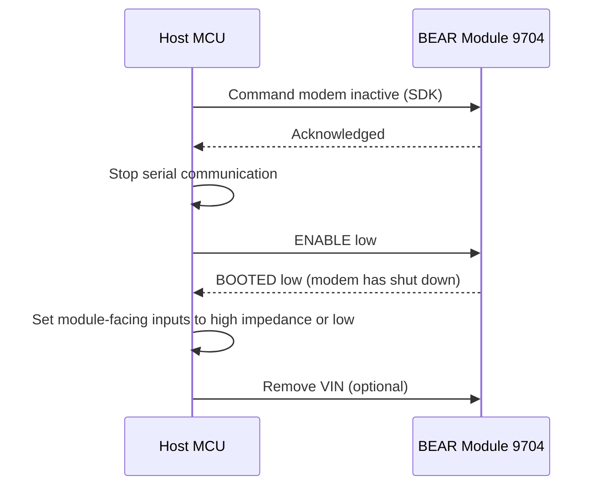

# 03 Hardware Interface

Document ID: BEAR-HI-9704 | Revision: P1 | Status: Preliminary

This document defines how a host system connects to the BEAR Module 9704. The signal set, directions and sequencing below are defined. Connector selection and electrical limits remain **[Pending decision]** and will be frozen and verified before the Rev A datasheet is released.

## Signals

Directions are relative to the module. A machine-readable version is in [`hardware/interfaces/bear-9704_signals.csv`](../hardware/interfaces/bear-9704_signals.csv).

| Signal | Direction | Type | Function | Required |
|---|---|---|---|---|
| VIN | Input | Power | Main supply | Yes |
| GND | Reference | Ground | Power and signal return | Yes |
| ENABLE | Input | Logic | High switches the modem on, low switches it off | Yes |
| BOOTED | Output | Logic | High when the modem has finished booting. Low after shutdown | Yes |
| TXD | Output | Logic | Serial data from the module (host receives) | Yes |
| RXD | Input | Logic | Serial data to the module (host transmits) | Yes |
| TX_ACTIVE | Output | Logic | High while the modem is transmitting | Optional |
| WAKE_IN | Input | Logic | Reserved for host-controlled low-power wake | Optional |
| WAKE_OUT | Output | Logic | Reserved for waking the host on a modem event | Optional |
| ANT | RF | RF | Antenna connection | Yes |

Output states other than BOOTED are undefined while the module is not booted. Treat TXD as invalid until BOOTED is high.

## Serial interface

| Parameter | Value |
|---|---|
| Format | 8 data bits, no parity, 1 stop bit (8N1) |
| Baud rate | 230400 (as used by the SDK reference port) |
| Flow control | None |
| Protocol | JSPR, the 9704's JSON-based command protocol, implemented by the SDK |
| Logic levels | 3.3 V CMOS proposed; thresholds, absolute limits and unpowered-host behavior **[Pending decision]** |

At 230400 baud a byte arrives about every 43 microseconds. Use a receive interrupt or DMA with a buffer, not polling. Your clock source must generate this baud rate accurately. See [Integration guide](06_Integration_Guide.md).

## Power sequencing

The modem must complete a full start-up and shutdown cycle. The host is responsible for the order of events. The SDK performs this sequence for you.

### Start-up

1. Before power is applied, hold every host pin that connects to a module input at high impedance or low. This prevents back-powering the module through its input protection.
2. Apply VIN.
3. Drive ENABLE high.
4. Wait for BOOTED to go high. The SDK waits up to `TS_BOOT_TIMEOUT_MS`.
5. Only now initialise the UART pins and start communicating.

### Shutdown

1. Stop communicating. The SDK commands the modem inactive first.
2. Drive ENABLE low.
3. Wait for BOOTED to go low.
4. Set module-facing pins to high impedance or low.
5. Only now may VIN be removed.

### Rules

- After ENABLE goes high, wait for BOOTED high before driving ENABLE low again.
- After ENABLE goes low, wait for BOOTED low before driving ENABLE high again.
- Never remove VIN before BOOTED has gone low, unless the supply is lost unexpectedly. The module's energy storage is intended to help in that case (target). See [04 Power management](04_Power_Management.md).

The Iridium 9704 modem requires this handshake. Interrupting a boot or shutdown can damage it.

## Timing parameters

| Symbol | Parameter | Value |
|---|---|---|
| t_BOOT | ENABLE high to BOOTED high | TBD — characterize and set timeout margin **[Pending decision]** |
| t_DOWN | ENABLE low to BOOTED low | TBD — characterize **[Pending decision]** |
| t_VIN | VIN valid to ENABLE allowed | TBD — derive from power-stage startup **[Pending decision]** |
| t_UART | BOOTED high to first serial command accepted | TBD — verify against modem behavior **[Pending decision]** |

The SDK uses a generous default boot timeout (30 s). It is configurable with `TS_BOOT_TIMEOUT_MS`.

## Host compatibility

The interface is designed for 3.3 V class microcontrollers. Confirm that your microcontroller's logic levels meet the datasheet limits. The proposed host-I/O level is 3.3 V CMOS **[Pending decision]**. Confirm the final input thresholds, output levels, absolute maximum ratings and unpowered-host behavior in the released datasheet. Do not connect 5 V logic directly unless explicitly permitted by that specification.

## Connector

| Item | Status |
|---|---|
| Host connector type and pitch | Select a keyed, polarized connector with a documented mating part **[Pending decision]** |
| RF connector (connector configuration) | Select by enclosure, RF loss and antenna SKU **[Pending decision]** |
| Mating parts and cable assemblies | Publish manufacturer part numbers with the connector selection **[Pending decision]** |
| Evaluation adapter board | Define and publish with the evaluation-kit interface package **[Pending decision]** |
