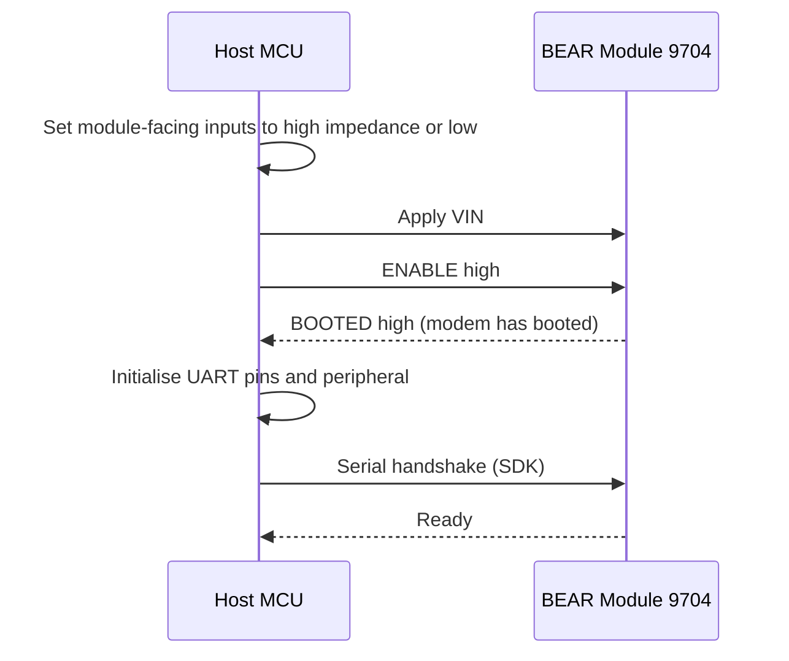
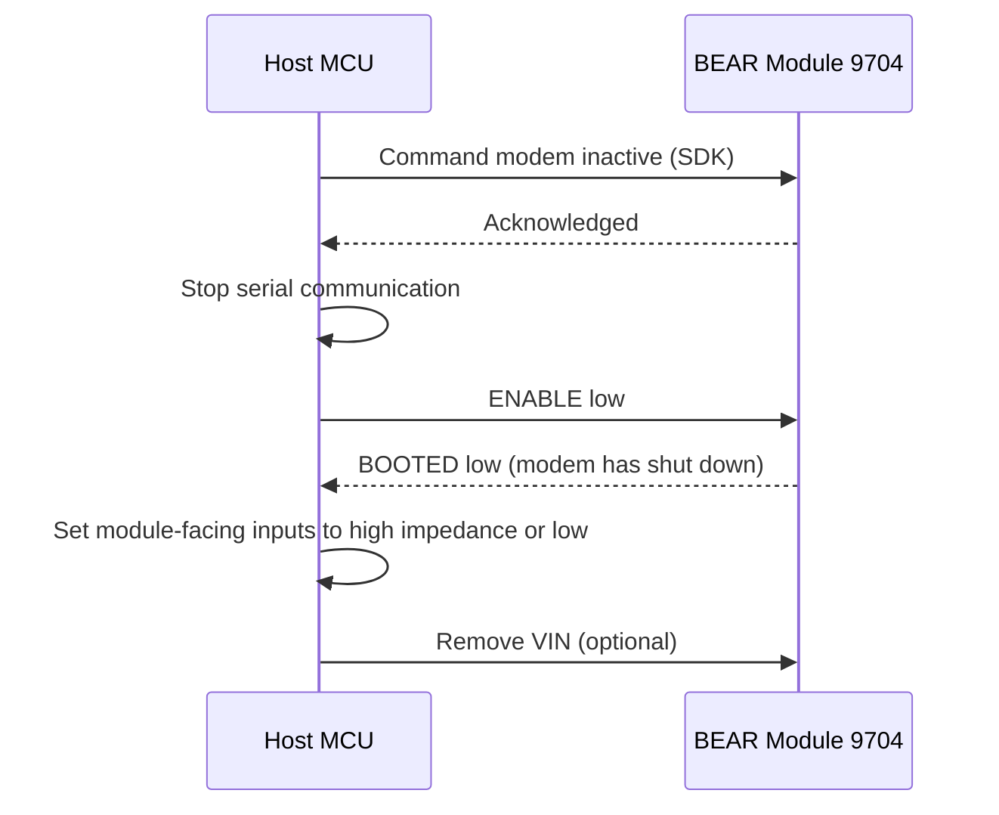

# 03 Hardware Interface

Document ID: BEAR-HI-9704 | Revision: P2 | Status: Preliminary (Rev A design values; verification pending at EVT)

This document defines how a host system connects to the BEAR Module 9704. The signal set, directions and sequencing below are defined. Connector, pin assignment and electrical limits are Rev A design values; hardware verification is pending at EVT. Native design files are not included in this SDK.

## Signals

Directions are relative to the module. A machine-readable version is in [`hardware/interfaces/bear-9704_signals.csv`](../hardware/interfaces/bear-9704_signals.csv).

| Signal | Direction | Type | Function | Required |
|---|---|---|---|---|
| VIN | Input | Power | Main supply | Yes |
| GND | Reference | Ground | Power and signal return | Yes |
| ENABLE | Input | Logic | High switches the modem on, low switches it off | Yes |
| BOOTED | Output | Logic | High when the modem has finished booting. Low after shutdown | Yes |
| TXD | Output | Logic | Serial data from the module (host receives) | Yes |
| RXD | Input | Logic | Serial data to the module (host transmits) | Yes |
| TX_ACTIVE | Output | Logic | High while the modem is transmitting | Optional |
| WAKE_IN | Input | Logic | Reserved for host-controlled low-power wake | Optional |
| WAKE_OUT | Output | Logic | Reserved for waking the host on a modem event | Optional |
| ANT | RF | RF | Antenna connection | Yes |

In Rev A, ENABLE has a 100 kΩ pull-down (modem off by default), BOOTED has a 100 kΩ pull-down, and the modem TXD line has a 100 kΩ pull-up (idle high). WAKE_IN and WAKE_OUT are on test pads TP10 and TP9 only, not on the host connector. Treat TXD as invalid until BOOTED is high.

## Serial interface

| Parameter | Value |
|---|---|
| Format | 8 data bits, no parity, 1 stop bit (8N1) |
| Baud rate | 230400 (as used by the SDK reference port) |
| Flow control | None |
| Protocol | JSPR, the 9704's JSON-based command protocol, implemented by the SDK |
| Logic levels | 3.3 V CMOS through SN74LVC1G125 buffers. See [Host compatibility](#host-compatibility) |

At 230400 baud a byte arrives about every 43 microseconds. Use a receive interrupt or DMA with a buffer, not polling. Your clock source must generate this baud rate accurately. See [Integration guide](06_Integration_Guide.md).

## Power sequencing

The modem must complete a full start-up and shutdown cycle. The host is responsible for the order of events. The SDK performs this sequence for you.

### Start-up

1. Before power is applied, hold every host pin that connects to a module input at high impedance or low. This prevents back-powering the module through its input protection.
2. Apply VIN and wait t_VIN (≥ 35 s) while the energy-storage bank charges.
3. Drive ENABLE high.
4. Wait for BOOTED to go high. The SDK waits up to `TS_BOOT_TIMEOUT_MS`.
5. Only now initialise the UART pins and start communicating.

### Shutdown

1. Stop communicating. The SDK commands the modem inactive first.
2. Drive ENABLE low.
3. Wait for BOOTED to go low.
4. Set module-facing pins to high impedance or low.
5. Only now may VIN be removed.

### Rules

- After ENABLE goes high, wait for BOOTED high before driving ENABLE low again.
- After ENABLE goes low, wait for BOOTED low before driving ENABLE high again.
- Never remove VIN before BOOTED has gone low, unless the supply is lost unexpectedly. The module's 2.5 F energy-storage bank is intended to help in that case; ride-through performance has not been measured. See [04 Power management](04_Power_Management.md).

The Iridium 9704 modem requires this handshake. Interrupting a boot or shutdown can damage it.

## Timing parameters

| Symbol | Parameter | Value |
|---|---|---|
| t_BOOT | ENABLE high to BOOTED high | Not published by Iridium. Characterize at EVT |
| t_DOWN | ENABLE low to BOOTED low | Not published by Iridium. Characterize at EVT |
| t_VIN | VIN valid to ENABLE allowed | ≥ 35 s. The bank charges from empty in 26 s typical, longer if the charger is in thermal regulation. Rev A has no hardware supervisor, so the host must wait |
| t_UART | BOOTED high to first serial command accepted | Not published by Iridium. Characterize at EVT |

The SDK uses a generous default boot timeout (30 s). It is configurable with `TS_BOOT_TIMEOUT_MS`.

## Host compatibility

The interface is designed for 3.3 V class microcontrollers. Every host signal passes through an SN74LVC1G125 buffer powered from the module's 3.3 V I/O rail.

| Parameter | Value |
|---|---|
| Module input V_IH / V_IL (ENABLE, RXD) | ≥ 2.0 V / ≤ 0.8 V |
| Module input range | 0 to 5.5 V; inputs are 5 V tolerant |
| Module output V_OH (BOOTED, TXD, TX_ACTIVE) | ≥ 2.4 V at −16 mA; 3.3 V nominal |
| Module output V_OL | ≤ 0.4 V at 16 mA |
| Unpowered behavior | I_off ≤ ±10 µA: no back-powering when either the host or the module is unpowered |

5 V hosts may drive ENABLE and RXD directly. A 5 V host input must accept 2.4 V as high; otherwise add a level translator on BOOTED, TXD and TX_ACTIVE.

## Connector

| Item | Status |
|---|---|
| Host connector type and pitch | J1: Molex Micro-Fit 3.0 43045-1012, 2 × 5, 3.0 mm pitch, keyed and polarized |
| Host pin assignment | 1, 2 VIN · 3, 4 GND · 5 ENABLE · 6 BOOTED · 7 TXD · 8 RXD · 9 TX_ACTIVE · 10 reserved (no connect) |
| RF connector | J2: Amphenol 132134 SMA jack, vertical, 50 Ω |
| Mating parts | Molex 43025-1000 housing with 43030-0007 crimp terminals; SMA plug antenna or cable |
| Evaluation adapter board | Define and publish with the evaluation-kit interface package **[Pending decision]** |
