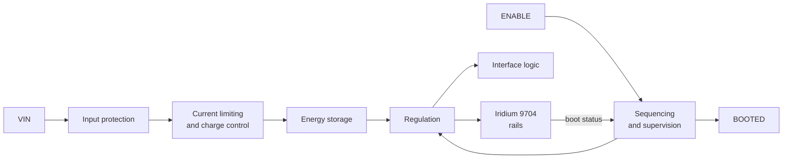

# 04 Power Management

Document ID: BEAR-PM-9704 | Revision: P1 | Status: Preliminary

## What power management means

A satellite modem is a demanding electrical load. Most of the time it draws little. When it transmits, it draws short bursts of much higher current. A supply sized only for a typical microcontroller can sag during a burst. The modem or the microcontroller can then reset, and messages fail in ways that are hard to diagnose.

A power-managed module takes this problem off your design. In the BEAR Module, power management means four jobs:

| Job | What it does for you |
|---|---|
| **Protect** | Guards the input against reversed connections, over-voltage and transients from cables and batteries |
| **Regulate** | Converts your supply into the exact voltages the modem needs |
| **Store energy** | Holds energy locally so transmit bursts do not collapse your supply or require an oversized source |
| **Sequence** | Starts and stops the modem in the order it requires, with a single ENABLE and BOOTED handshake |

## Power architecture

| Block | Function | Implementation |
|---|---|---|
| Input protection | Reverse polarity, over-voltage and surge protection | Coming soon |
| Current limiting and charge control | Limits inrush and the average current drawn from your source | Coming soon |
| Energy storage | Supplies transmit-burst current | Coming soon |
| Regulation | Produces modem and interface rails with low ripple | Coming soon |
| Sequencing and supervision | Orders the rails and applies the ENABLE and BOOTED handshake | Defined |

## What it means for your design

- **Smaller source.** Because energy is stored on the module, your supply is sized for the average load, not the peak. This is a key reason satellite integrations with small batteries and solar panels work.
- **Charge time.** A module with energy storage needs time to charge before it can transmit. Expect a start-up delay after power is first applied. The delay is published as a parameter. Design your duty cycle around it.
- **Brown-out ride-through (target).** If your supply is lost unexpectedly, stored energy is intended to give the modem time to finish and shut down cleanly. The hold-up time is published at Rev A.
- **Supply options.** The module is designed to run from a battery or a regulated DC supply. Accepted voltage ranges are published at Rev A.

## Power budget worksheet

Use this template to size your supply once the datasheet values are published.

| State | Module current | Duration | Per message |
|---|---|---|---|
| Off (ENABLE low) | Coming soon | Most of the time | |
| Boot | Coming soon | t_BOOT | |
| Idle, registered | Coming soon | Until sent | |
| Transmit burst | Coming soon (peak and average) | Per message | |
| Shutdown | Coming soon | t_DOWN | |

Energy per message depends on how long the modem needs to find a satellite. Sky view and antenna quality matter. See [05 Antenna and RF](05_Antenna_and_RF.md).

**Duty cycling.** For battery systems, the lowest energy per message comes from keeping the module off between reports, starting it just before a send, and shutting it down after delivery is confirmed. The SDK supports this with `ts_bear_start()` and `ts_bear_shutdown()`.

## Operational recommendations

| Recommendation | Reason |
|---|---|
| Keep wiring between your supply and VIN short and heavy | Voltage drop during burst charging |
| Place the module near its source and keep its antenna cable short | Reduces losses and noise |
| Do not remove VIN while BOOTED is high | Allow a clean shutdown |
| Keep ENABLE low during your own power-up | Avoids starting the modem before your supply is stable |
| Use the SDK's `TS_EVENT_STOPPED` before cutting power | It confirms the shutdown handshake finished |
