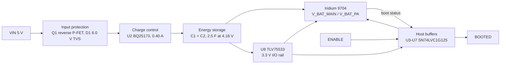

# 04 Power Management

Document ID: BEAR-PM-9704 | Revision: P2 | Status: Preliminary (Rev A design values; measurement pending at EVT)

## What power management means

A satellite modem is a demanding electrical load. Most of the time it draws little. When it transmits, it draws short bursts of much higher current. A supply sized only for a typical microcontroller can sag during a burst. The modem or the microcontroller can then reset, and messages fail in ways that are hard to diagnose.

A power-managed module takes this problem off your design. In the BEAR Module, power management means four jobs:

| Job | What it does for you |
|---|---|
| **Protect** | Guards the input against reversed connections, over-voltage and transients from cables and batteries |
| **Regulate** | Converts your supply into the exact voltages the modem needs |
| **Store energy** | Holds energy locally so transmit bursts do not collapse your supply or require an oversized source |
| **Sequence** | Starts and stops the modem in the order it requires, with a single ENABLE and BOOTED handshake |

## Power architecture

This is the Rev A design summary. Measured customer specifications will be published in the
[datasheet](../datasheet/BEAR-9704_Datasheet.md) after EVT. Internal engineering reports are not included in this SDK.

| Block | Function | Rev A implementation |
|---|---|---|
| Input protection | Reverse-polarity and transient protection | Q1 DMP3099L high-side P-FET (reverse polarity: no current flows); D1 SMAJ6.0A TVS (V_RWM 6.0 V, clamps transients); U2 over-voltage protection to 18 V |
| Current limiting and charge control | Limits inrush and source current | U2 BQ25173 supercapacitor charger. Charge current 0.36 / 0.40 / 0.44 A (min / typ / max), set by a 750 Ω R_ISET. This also limits inrush |
| Energy storage | Supplies transmit-burst current | Two 5 F / 2.7 V supercapacitors in series (2.5 F), charged to 4.18 V (4.14 to 4.23 V), with balancing resistors. Usable energy and burst margin require EVT measurement and confirmation against permitted modem limits **[Pending decision]** |
| Regulation | Produces modem and interface rails | The modem supply runs directly from the bank. U8 TLV75533 LDO makes the 3.3 V I/O and buffer rail. Modem supply limits are not published here pending publication clearance |
| Sequencing and supervision | Applies the ENABLE and BOOTED handshake | ENABLE is buffered to the modem with a 100 kΩ pull-down (off by default). No hardware supervisor in Rev A: the host waits t_VIN ≥ 35 s after power-up |

## What it means for your design

- **Source sizing.** Use a regulated 5.0 V ±5 % (4.75 to 5.25 V) source rated for at least 0.5 A. The module draws at most 0.44 A from VIN, including during transmission; the bank supplies the bursts. For a weaker 0.2 A source, Rev A can be built with R_ISET = 1.5 kΩ (0.18 to 0.22 A), with slower recharge.
- **Charge time.** After VIN is applied, the bank charges from empty in about 26 s, up to about 60 s if the charger is in thermal regulation. Wait at least 35 s (t_VIN) before driving ENABLE high. After a short power interruption the bank is still charged, and the wait is shorter.
- **Brown-out ride-through (target).** Energy storage is intended to support a clean shutdown after VIN is lost. Hold-up energy, duration and shutdown performance require EVT measurement **[Pending decision]**; do not assume guaranteed ride-through. The charger is designed to block reverse current.
- **Supply options.** Regulated DC only. Above 6 V the TVS conducts; reversed polarity is blocked.

## Power budget worksheet

Iridium does not publish the 9704's supply current, so module currents are measured at EVT through the Rev A 10 mΩ sense resistor. Until then, use the design envelope below.

| State | Module current | Duration | Per message |
|---|---|---|---|
| Off (ENABLE low, bank full) | Characterize at EVT; Rev A test limit < 5 mA | Most of the time | |
| Boot | Characterize at EVT | t_BOOT | |
| Idle, registered | Characterize at EVT; design assumption < 0.15 A | Until sent | |
| Transmit burst | From the bank: 2.0 A design envelope, not a modem specification. Burst timing and average current require EVT measurement **[Pending decision]**. From VIN: ≤ 0.44 A design value | Per message | |
| Shutdown | Characterize at EVT | t_DOWN | |

Energy per message depends on how long the modem needs to find a satellite. Sky view and antenna quality matter. See [05 Antenna and RF](05_Antenna_and_RF.md).

**Duty cycling.** For battery systems, the lowest energy per message comes from keeping the module off between reports, starting it just before a send, and shutting it down after delivery is confirmed. The SDK supports this with `ts_bear_start()` and `ts_bear_shutdown()`.

## Operational recommendations

| Recommendation | Reason |
|---|---|
| Keep wiring between your supply and VIN short and heavy | Voltage drop during burst charging |
| Place the module near its source and keep its antenna cable short | Reduces losses and noise |
| Do not remove VIN while BOOTED is high | Allow a clean shutdown |
| Keep ENABLE low during your own power-up | Avoids starting the modem before your supply is stable |
| Use the SDK's `TS_EVENT_STOPPED` before cutting power | It confirms the shutdown handshake finished |
