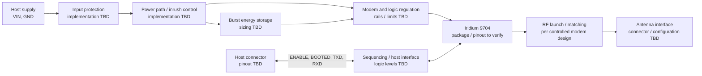

# BEAR Module 9704 — Initial Design Basis

Document ID: BEAR-DI-9704 | Revision: P0 | Status: Preliminary, CAD-neutral

## Purpose and limits

This document turns the BEAR product brief into a first-pass design input package that can later be captured in Altium, KiCad, or another CAD tool. It records intended functional relationships and layout considerations.

This document is not for fabrication.

## Functional topology

Conceptual inter-block connections are listed in [`BEAR-9704_Block_Connections.csv`](BEAR-9704_Block_Connections.csv). They do not constitute an electrical netlist.

## Interface baseline

The signal names and functions below come from the BEAR hardware interface definition. Connector pins, voltage levels, pull states, protection, and absolute limits remain open.

| Signal group | Signals | Design input |
|---|---|---|
| Supply | VIN, GND | Host supply enters through input protection and a controlled power path. Input range and transient profile are open. |
| Host control | ENABLE, BOOTED | Preserve the documented start/stop handshake. Determine polarity, thresholds, default states, and power-off behavior from controlled modem/interface requirements. |
| UART | TXD, RXD | Preserve the documented 230400 baud, 8N1 interface. Confirm modem I/O levels, timing, reset behavior, and whether translation is required. |
| Optional host signals | TX_ACTIVE, WAKE_IN, WAKE_OUT | Reserved in the interface definition; population and electrical implementation are open. |
| RF | ANT | Use the controlled modem RF reference design and antenna requirements. Impedance, matching, connector, keep-out, and approval scope require confirmation. |

See the [hardware interface](../../docs/03_Hardware_Interface.md), [power management](../../docs/04_Power_Management.md), and [antenna and RF](../../docs/05_Antenna_and_RF.md) documents for current product-level intent.

## Preliminary PCB partitioning

These are placement and routing principles:

1. Reserve distinct regions for modem/package, power conversion and energy storage, host interface, and RF launch.
2. Keep the modem supply loop and energy-storage path short and low impedance; final copper sizing requires the controlled peak-current and thermal requirements.
3. Keep the RF route short, with a continuous reference plane and geometry set by the approved stack-up and impedance calculation. Do not select trace width from a generic rule of thumb.
4. Keep switching power nodes and fast digital edges away from the RF feed. Confirm the final separation and return-path strategy during layout review.
5. Provide accessible probing for VIN, modem rails, ENABLE, BOOTED, and UART. Add RF test access only if the RF design and production test plan call for it.
6. Do not define dimensions, layer count, materials, controlled impedance, connector footprints, or manufacturing tolerances until mechanical, RF, and supplier constraints are approved.

## Inputs [Pending decision]

| Input | Current state | Needed to close |
|---|---|---|
| Controlled modem hardware guide and package drawing | Open | Iridium or authorized module-vendor document and revision |
| Modem rails, tolerances, ramp, peak/average current, and sequencing | Open | Controlled requirements and operating profiles |
| Host input voltage range, source impedance, and transient profile | Open | Product requirement and installation assumptions |
| Host I/O thresholds, absolute maximums, pull states, and unpowered behavior | Open | Controlled modem limits and host-interface design |
| RF reference circuit, matching, antenna, and test requirements | Open | Controlled modem RF documentation and intended antenna configuration |
| Host connector, pin assignment, mating part, and mechanical envelope | Open | Product/mechanical decision |
| Board outline, mounting, enclosure, environment, and stack-up | Open | Mechanical and manufacturing decisions |
| Power architecture and component qualification | Open | Power budget, thermal analysis, sourcing, and verification plan |

## Candidate external reference

The [community Iridium 9704 KiCad library](https://github.com/ndoo/iridium-9704-kicad-lib) states that its generated symbol/footprint represents an 88-pad LGA measuring 31.5 mm × 42.0 mm. This was used for investigation.

We still need to verify pad geometry, numbering, courtyard, keep-outs, and 3D model with the controlled package drawing before use. No third-party library files have been copied into this repository.

## Entry criteria for CAD conversion

Start component-level schematic capture only after the controlled modem package/electrical/RF references and the module interface decisions are available. Start PCB placement after the board outline, connector locations, stack-up, RF constraints, and power-stage requirements are approved. Run schematic review, ERC/DRC, power and thermal analysis, RF review, and prototype verification before any fabrication release.
