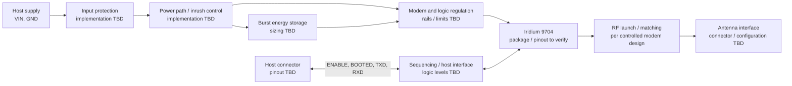

# BEAR Module 9704 — Initial Design Basis

Document ID: BEAR-DI-9704 | Revision: P0 | Status: Preliminary, CAD-neutral

## Purpose and limits

This document turns the BEAR product brief into a first-pass design input package that can later be captured in Altium, KiCad, or another CAD tool. It records intended functional relationships and layout considerations.

This document is not for fabrication.

## Functional topology

Conceptual inter-block connections are listed in [`BEAR-9704_Block_Connections.csv`](BEAR-9704_Block_Connections.csv). They do not constitute an electrical netlist.

## Interface baseline

The signal names and functions below come from the BEAR hardware interface definition. Connector pins, voltage levels, pull states, protection, and absolute limits remain open.

| Signal group | Signals | Design input |
|---|---|---|
| Supply | VIN, GND | Host supply enters through input protection and a controlled power path. Input range and transient profile are open. |
| Host control | ENABLE, BOOTED | Documented start/stop handshake; electrical thresholds, default states, and power-off behavior remain open. |
| UART | TXD, RXD | Documented 230400 baud, 8N1 interface; modem I/O levels, timing, reset behavior, and level translation remain open. |
| Optional host signals | TX_ACTIVE, WAKE_IN, WAKE_OUT | Reserved in the interface definition; population and electrical implementation are open. |
| RF | ANT | RF implementation depends on controlled modem and antenna requirements. Impedance, matching, connector, keep-out, and approval scope remain open. |

See the [hardware interface](../../docs/03_Hardware_Interface.md), [power management](../../docs/04_Power_Management.md), and [antenna and RF](../../docs/05_Antenna_and_RF.md) documents for current product-level intent.

## Preliminary PCB partitioning

The preliminary layout concept includes:

1. Separate regions for modem/package, power conversion and energy storage, host interface, and RF launch.
2. Short, low-impedance modem supply and energy-storage paths; copper sizing depends on peak-current and thermal requirements.
3. A short RF route with a continuous reference plane; routing geometry depends on the final stack-up and impedance requirements.
4. Separation of switching power nodes and fast digital edges from the RF feed.
5. Test access for VIN, modem rails, ENABLE, BOOTED, and UART; RF test access remains subject to the selected configuration.
6. Dimensions, layer count, materials, connector footprints, and manufacturing tolerances remain **[Pending decision]**.

## Inputs [Pending decision]

| Input | Current state | Specification basis |
|---|---|---|
| Controlled modem hardware guide and package drawing | Open | Iridium or authorized module-vendor document and revision |
| Modem rails, tolerances, ramp, peak/average current, and sequencing | Open | Controlled requirements and operating profiles |
| Host input voltage range, source impedance, and transient profile | Open | Product requirement and installation assumptions |
| Host I/O thresholds, absolute maximums, pull states, and unpowered behavior | Open | Controlled modem limits and host-interface design |
| RF reference circuit, matching, antenna, and test requirements | Open | Controlled modem RF documentation and intended antenna configuration |
| Host connector, pin assignment, mating part, and mechanical envelope | Open | Product/mechanical decision |
| Board outline, mounting, enclosure, environment, and stack-up | Open | Mechanical and manufacturing decisions |
| Power architecture and component qualification | Open | Power budget, thermal analysis, sourcing, and verification plan |

## Candidate external reference

The [community Iridium 9704 KiCad library](https://github.com/ndoo/iridium-9704-kicad-lib) describes an 88-pad LGA measuring 31.5 mm × 42.0 mm. This is a candidate reference, not a verified BEAR footprint.

Pad geometry, numbering, courtyard, keep-outs, and the 3D model have not yet been verified against the controlled package drawing. No third-party library files have been copied into this repository.

## Design package availability

Component-level schematics, routed PCB files, and fabrication outputs are not yet available. Their release depends on finalized electrical, mechanical, and RF specifications and hardware verification. See the [hardware index](../README.md) for deliverable status.
