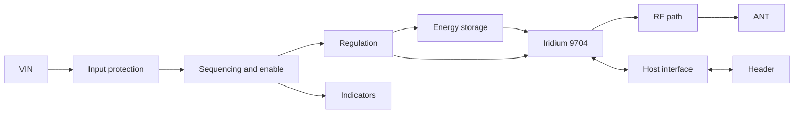

# Schematics

Abstract, block-level description of the BEAR Module 9704 circuit. Full controlled schematics and the native Altium PCB design package are planned for publication before product launch; component values will be released with the appropriate design revision.

| Block | Function | Status |
|---|---|---|
| Input protection | Reverse polarity, overvoltage and transient protection | In development |
| Sequencing and enable | Applies the ENABLE and BOOTED handshake and orders the rails | In development |
| Regulation | Produces the modem supply from VIN | In development |
| Energy storage | Supplies transmit bursts so the host source can be modest | In development |
| Host interface | UART, ENABLE, BOOTED, optional TX_ACTIVE, with level compatibility | In development |
| RF path | Modem to antenna connector or qualified antenna | In development |
| Indicators | Power and ready | Placement, electrical details and indication behavior **[Pending decision]** |

Related: [03 Hardware interface](../../docs/03_Hardware_Interface.md), [04 Power management](../../docs/04_Power_Management.md), [05 Antenna and RF](../../docs/05_Antenna_and_RF.md).
