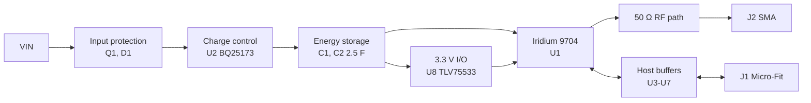

# Schematics

Customer-facing block-level description of the BEAR Module 9704 Rev A design. Native KiCad schematics, modem pad
maps and internal engineering reports are not included in this SDK. Approved schematic deliverables will be
published separately with revision metadata, applicable licenses and required attribution. This summary is not a fabrication definition.

| Block | Function | Rev A implementation |
|---|---|---|
| Input protection | Reverse polarity, overvoltage and transient protection | Q1 DMP3099L P-FET, D1 SMAJ6.0A TVS, U2 18 V OVP |
| Charge control | Limits input current and charges the bank | U2 BQ25173, 0.40 A typical, 4.18 V |
| Energy storage | Supplies transmit bursts so the host source can be modest | C1, C2 5 F in series (2.5 F), 15 kΩ balancing |
| Regulation | Modem and logic rails | Modem V_BAT direct from the bank; U8 3.3 V LDO for V_IO and buffers |
| Host interface and sequencing | UART, ENABLE, BOOTED, TX_ACTIVE with level compatibility and unpowered isolation | U3-U7 SN74LVC1G125; 100 kΩ default-state resistors |
| RF path | Modem to antenna connector | 50 Ω microstrip to J2 SMA |
| Indicators | Power and ready | None in Rev A; CHG_STAT/CHG_PG on test pads. LEDs considered for Rev B **[Pending decision]** |

Related: [03 Hardware interface](../../docs/03_Hardware_Interface.md), [04 Power management](../../docs/04_Power_Management.md), [05 Antenna and RF](../../docs/05_Antenna_and_RF.md).
