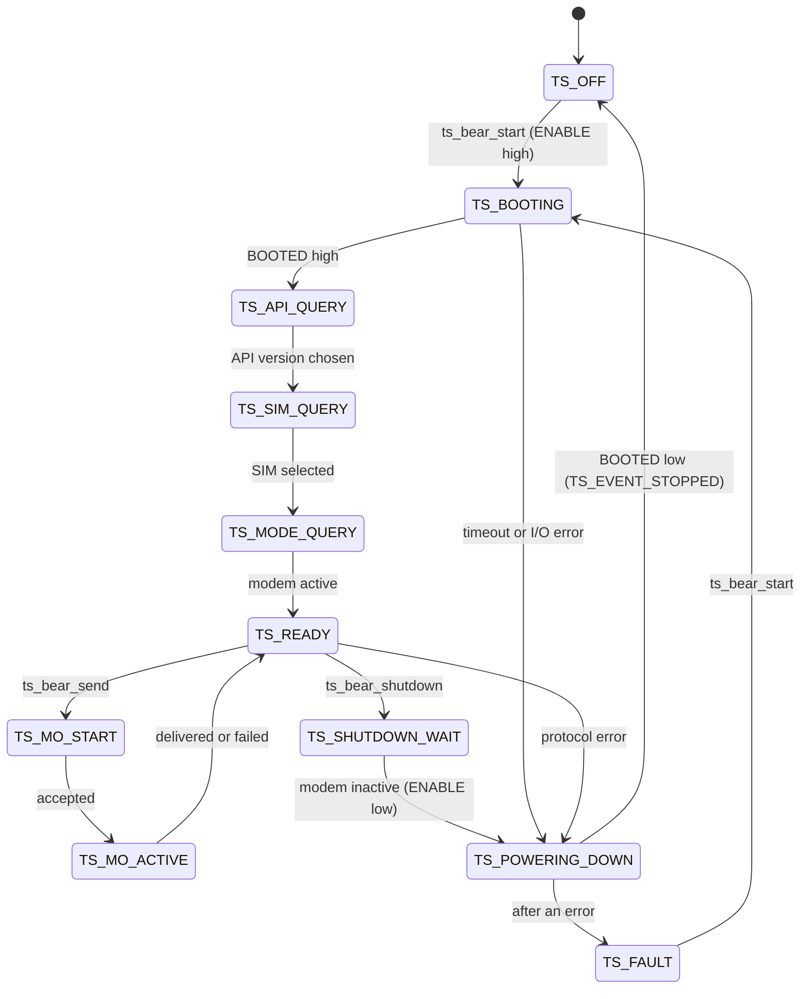

# Design notes

For firmware engineers who want to know how the driver works, what it guarantees, and where it deliberately does not do something. Nothing here has been measured on a BEAR Module or a microcontroller yet. Where a number comes from a computer build, it says so.

## Shape of the code

```text
your application
      |  ts_bear_start / send / shutdown / poll        include/ts_bear9704.h
      v
driver core  ts_bear9704.c  (state machine, timeouts, line buffers)
      |-- ts_setup.c   start-up handshake
      |-- ts_mo.c      sending a message
      |-- ts_mt.c      receiving a message (optional)
      |-- ts_cmd.c     builds command lines (no stdio)
      |-- ts_jspr.c, ts_crc.c, ts_base64.c   protocol helpers
      |  ts_platform_t  (seven functions)             include/ts_platform.h
      v
your port    ports/msp430f169, ports/posix, ports/template
```

Only the port touches registers, pins or the operating system. Everything above it is portable C99 and is tested on a computer. `ts_names.c` (logging names) and `ts_activation.c` (console text) are optional and sit outside the core.

## Execution model

The driver is **cooperative and polled**. You call `ts_bear_poll()` from your main loop. There are no threads, callbacks from interrupts, or hidden timers.

| Rule | Why |
|---|---|
| Call `ts_bear_poll()` every few milliseconds | The 230400 baud UART delivers a byte about every 43 µs. Your port's receive ring buffer absorbs the gap between polls. Size it for your loop period |
| Never call the driver from an interrupt | The driver is not re-entrant. Interrupts only move bytes into ring buffers and count milliseconds |
| Each call does bounded work | At most `TS_POLL_BYTE_BUDGET` bytes are read, one line is parsed, and one segment is encoded. Nothing waits |
| Events arrive inside `ts_bear_poll()` | The callback runs in your main loop context, so it needs no locking. Keep it short. Do not call `ts_bear_poll()` from it |
| Sleep between polls | Wake on any interrupt (the examples use a 1 ms tick) |

### Worst-case time per poll

Proportional to `TS_POLL_BYTE_BUDGET` (default 64) plus one parse of a line of up to `TS_LINE_CAP` bytes. Measure it with your toolchain on your target before choosing a watchdog period. Validated target measurements **[Pending decision]** will be published with each platform port.

## State machine



`TS_API_SELECT` and `TS_SIM_SET` are the short waits after the driver changes a setting. They are folded into the arrows above.

`TS_OFF` and `TS_FAULT` both mean "powered down". Use `ts_bear_state()` to read the state.

## Timeouts

Every wait ends. None can hang the driver.

| Wait | Limit | On expiry |
|---|---|---|
| BOOTED to go high | `TS_BOOT_TIMEOUT_MS` (30 s) | Power down, `TS_EVENT_ERROR` with `TS_ERR_TIMEOUT`, state `TS_FAULT` |
| BOOTED to go low | `TS_BOOT_TIMEOUT_MS` | Same |
| A reply during start-up or shutdown | `TS_CMD_TIMEOUT_MS` (5 s) | Power down, fault |
| A reply to a signal or IMEI request | `TS_CMD_TIMEOUT_MS` | `TS_EVENT_ERROR` (`TS_ERR_TIMEOUT`). The driver stays ready |
| A message to finish | `TS_MO_TIMEOUT_MS` (10 min) | `TS_EVENT_MO_FAILED` (`TS_ERR_TIMEOUT`). The outcome is unknown |
| An incoming message to complete | `TS_MT_TIMEOUT_MS` | Partial message discarded, `TS_EVENT_MT_DROPPED` |

Timestamps are 32-bit milliseconds. Comparisons use signed subtraction, so the counter may wrap (about every 49 days) without effect.

## Memory

| Item | Value |
|---|---|
| Heap | None. No `malloc`, `calloc`, `realloc` or `free` |
| Recursion | None |
| Floating point | None |
| stdio (`printf` family) | None in the driver core. A CI test fails the build if it appears |
| Stack | Small and flat. Command lines are built in place, and the base64 encoder writes into the transmit buffer |
| Driver RAM | `sizeof(ts_bear9704_t)` is **800 bytes** with defaults and receive support, **728 bytes** without it. Measured on a 64-bit computer. A 16-bit MCU has smaller pointers, so expect a little less. Measure on your target |
| Flash | Per-target figures **[Pending decision]**; measure and publish with each validated platform port |

Buffer sizes follow `TS_LINE_CAP` (twice) and `TS_MAX_PAYLOAD` (up to twice), set in [`ts_config.h`](../include/ts_config.h). Invalid combinations fail at compile time.

`ts_activation.c` uses `snprintf` to format text for a console. It is not part of the driver. Leave it out if your flash is tight.

## Errors

| Mechanism | Use |
|---|---|
| Return codes (`ts_result_t`) | Every function that can fail returns one. Bad arguments and misuse are rejected, never asserted |
| Events (`TS_EVENT_ERROR`, `TS_EVENT_MO_FAILED`) | Problems found later, while polling |
| `TS_FAULT` | Unrecoverable for this session. The driver has powered the module down. Call `ts_bear_start()` to try again |

`ts_result_name()`, `ts_event_name()` and `ts_state_name()` give readable names for logs.

**No automatic retry.** A failed send can still have reached the network, and a repeat would be a duplicate. Your application decides, and puts a sequence number in the payload.

**Delivered is not accepted.** `TS_EVENT_MO_ACCEPTED` means the modem queued the message. Only `TS_EVENT_MO_DELIVERED` means it was acknowledged.

**Corruption check.** The driver appends a CRC-16 to each message and verifies it on received messages. It detects corruption. It does not authenticate or encrypt.

## Watchdog

The driver never blocks, so you can service a hardware watchdog from the main loop. Kick it in **one** place, after `ts_bear_poll()` returns and the application has run. The MSP430F169 port provides this behind `TS_F169_WATCHDOG` (off by default so the bench port works on any board). Choose a period longer than your measured worst-case loop time and shorter than you can tolerate a hang.

## Why the driver struct is visible

`ts_bear9704_t` is declared in the public header so you can place it in static memory with no heap. Its fields are private by convention. The alternative, an opaque handle backed by an internal pool, would hide the fields at the cost of a fixed instance count and a hidden allocator. For a driver that normally has one instance, the visible struct is the simpler trade. Do not read or write its fields. Use the accessor functions, which are covered by tests.

## Interrupts and shared data

The driver itself has none. The port owns the interrupts, and the F169 port shows the pattern:

- Single-producer, single-consumer ring buffers. The interrupt writes the head and the main loop writes the tail, or the reverse.
- Shared variables are `volatile`.
- A 32-bit millisecond counter is read with interrupts briefly disabled, because the read is more than one instruction on a 16-bit MCU.
- A lost byte is reported as an error from `serial_read()`, not silently dropped.
- Interrupt handlers do no parsing, formatting or logging.

## Coding standard

C99. The library builds clean with `-Wall -Wextra -Wpedantic -Wconversion -Wshadow -Wstrict-prototypes -Wmissing-prototypes -Wcast-qual -Wundef`. CI also builds with `-Werror`, runs the tests under AddressSanitizer and UBSan, and runs the Clang static analyzer. Fixed-width integer types are used throughout the public interface.

The code follows the usual embedded rules (no heap, no recursion, bounded loops, named constants, every wait has a timeout), and is written to be easy to check with a MISRA C tool. A formal compliance report is on the roadmap. If you need a checker now, run yours in CI against `src/`.

## Testing

| Layer | What | Where |
|---|---|---|
| Unit | CRC, base64, JSON field extraction, command builder, names | `tests/test_sdk.c` |
| Behavior | Start-up, IMEI, send, receive, shutdown handshake, boot timeout, repeated duty cycles | `tests/test_sdk.c` against `tests/sim_modem.c` |
| Faults | Timeouts, serial errors, bad replies, rejected sends and shutdowns, simulator fault injection; 100% line coverage of `src/` | `tests/test_faults.c`, `tests/coverage.sh` |
| Port syntax | MSP430F169 port and example compile against a host stub header | `tests/stubs/msp430.h` |
| Structure | No stdio formatting or heap in the core | `tests/check_core_symbols.sh` |
| Walk-through | The full workflow, printed | `examples/host/simulated_demo.c` |

**On the roadmap:** validation with the BEAR Module 9704 on target microcontrollers, covering timing, electrical behavior, long-duration operation and fault injection.

## Known limits

- One outgoing message at a time.
- One information request at a time, and none during a send.
- Receiving is available. Its field validation follows sending on the roadmap.
- UART settings are fixed by the module (230400, 8N1).
- Nothing is persisted. After power loss, you start again and your application decides what to resend.
